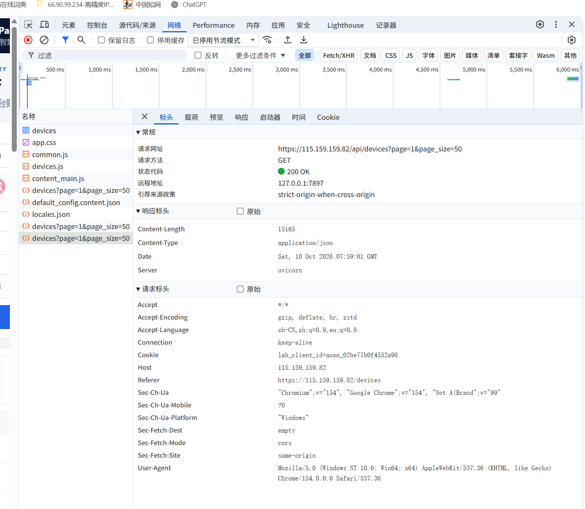
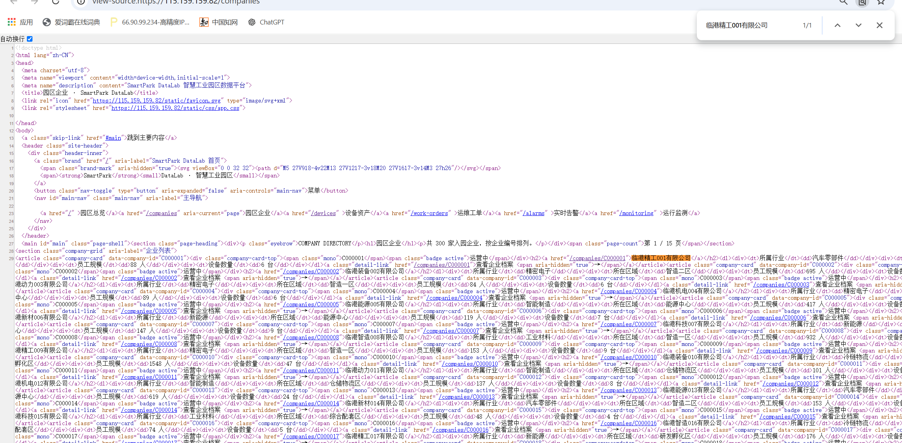
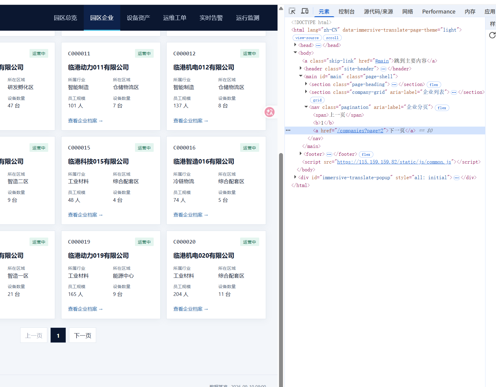
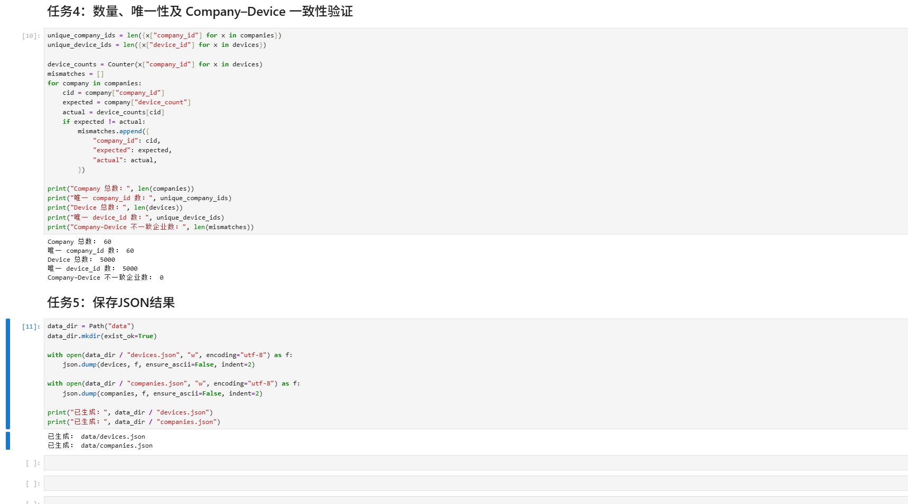

# Lab 1 实验报告

## 学生信息

- **姓名：** 李翔宇
- **学号：** 112404260129
- **班级：** 数据1241
- **GitHub 用户名：** xiangyuli88x
- **仓库地址：** https://github.com/xiangyuli88x/bigdata-collection-labs-112404260129

> 文件位置：`lab01/REPORT.md`  
> 完整代码保存在 `lab1_html_api.ipynb`。

---

# 任务 1：判断数据加载方式

## 1.1 Device：判断动态加载并找到 API

### 判断结果

- 页面：`/devices`
- 数据加载方式：动态加载
- 判断依据：设备页面的初始 HTML 中只有空表格，设备数据由 JavaScript 加载。浏览器 Network 中找到 `/api/devices` 请求，其返回状态为 `200 OK`、Content-Type 为 `application/json`，说明设备记录通过 API 动态加载。

### API 信息

- Request URL：`https://115.159.159.82/api/devices?page=1&page_size=50`
- Request Method：`GET`
- Query 参数：`page=1`、`page_size=50`

### 【截图 1】Device API 发现证据



> 截图中选中了设备 API 请求，Headers 显示完整地址及分页参数 `page=1`、`page_size=50`。

## 1.2 Company：判断静态加载

- 页面：`/companies`
- 数据加载方式：静态加载
- 判断依据：在 `/companies` 的“查看网页源代码”页面中，使用 Ctrl+F 搜索“临港精工001有限公司”，命中 `1/1`，并能看到对应的企业卡片 HTML，说明企业记录随初始 HTML 一起返回，可直接解析。

### 【截图 2】Company 静态加载证据



> 截图同时显示企业列表页源代码、企业名称查找框和高亮的匹配记录。

---

# 任务 2：Device API 分页采集

## 2.1 API 分页结构

| 含义 | JSON 字段 |
|---|---|
| 当前页 | `page` |
| 每页条数 | `page_size` |
| 设备总数 | `total` |
| 设备列表 | `items` |

## 2.2 关键代码

```python
total = data["total"]
page_size = data["page_size"]
total_pages = (total + page_size - 1) // page_size

devices = []
for page in range(1, total_pages + 1):
    r = requests.get(
        api_url,
        params={"page": page, "page_size": page_size},
        timeout=20,
    )
    r.raise_for_status()
    page_data = r.json()
    devices.extend(page_data["items"])
```

## 2.3 采集结果

- 每页条数：50
- 设备总数：5000
- 程序计算得到的总页数：100
- 最终采集设备数：5000
- 唯一 `device_id` 数：5000

总页数应由 API 返回的 `total` 和 `page_size` 动态计算，因为数据量或每页数量可能变化；直接写死页数容易漏采、重复请求空页，也降低代码复用性。

---

# 任务 3：Company HTML 解析

## 3.1 企业记录 Selector

- 企业记录 selector：`article.company-card`
- 第 1 页企业记录数：20

借助 AI 辅助分析实际 HTML 的 DOM 结构，确定 `article.company-card`，再用 `soup.select("article.company-card")` 验证第 1 页恰好匹配 20 条企业记录。该 selector 结合语义化标签 `article` 与 class `company-card`，含义明确，不依赖元素位置。

## 3.2 关键代码

```python
cards = soup.select("article.company-card")
card = cards[0]

company_id = card["data-company-id"]
name = card.select_one("h2 a").get_text(strip=True)
status = card.select_one(".badge").get_text(strip=True)

details = {}
for item in card.select("dl > div"):
    key = item.select_one("dt").get_text(strip=True)
    value = item.select_one("dd").get_text(strip=True)
    details[key] = value

industry = details["所属行业"]
zone = details["所在区域"]
device_count = int(details["设备数量"].replace("台", "").strip())
```

## 3.3 字段来源说明

1. 字段：`company_id`
   - 来自：HTML属性
   - 使用的方法：读取企业卡片的 `data-company-id` 属性。

2. 字段：`device_count`
   - 来自：文本
   - 使用的方法：将 `dt/dd` 转换为字典，读取“设备数量”，去掉“台”后转换为整数。

---

# 任务 4：Company “下一页”分页

## 4.1 下一页元素

- “下一页” selector：`nav.pagination a`
- 第 1 页 `href` 示例：`/companies?page=2`

### 【截图 3】Company “下一页”元素



## 4.2 关键代码

```python
next_link = next((a for a in soup.select("nav.pagination a")
                  if "下一页" in a.get_text(strip=True)), None)
next_href = next_link.get("href")
next_url = urljoin(current_url, next_href)
```

程序先请求并解析当前页，把本页企业加入列表，再从分页区域读取“下一页”的 `href`。使用 `urljoin()` 将相对路径转换为完整地址，然后把该地址作为下一轮循环的 `current_url`，连续执行3次。

## 4.3 三页采集结果

| 页码 | 企业数 |
|---|---:|
| 1 | 20 |
| 2 | 20 |
| 3 | 20 |
| **合计** | **60** |

- 唯一 `company_id` 数：60

---

# 任务 5：结果验证

## 5.1 最终结果

| 检查项 | 结果 |
|---|---:|
| Company 总数 | 60 |
| 唯一 `company_id` | 60 |
| Device 总数 | 5000 |
| 唯一 `device_id` | 5000 |
| Company–Device 不一致企业数 | 0 |

### 【截图 4】最终验证结果



## 5.2 一致性检查关键代码

```python
from collections import Counter

device_counts = Counter(x["company_id"] for x in devices)
mismatch_count = 0

for company in companies:
    cid = company["company_id"]
    expected = company["device_count"]
    actual = device_counts[cid]
    if expected != actual:
        mismatch_count += 1
```

`status_code == 200` 只表示服务器成功返回了响应，不能证明分页是否完整、字段解析是否正确、ID是否重复或两个数据源是否一致。因此还必须检查总数、唯一ID数量和 Company–Device 设备数量的一致性。

---

# 任务 6：保存采集结果

- `companies.json`：已生成
- `devices.json`：已生成

---

# 实验结论

Device 通过 API 分页采集，Company 通过 HTML 解析及“下一页”链接采集。最终得到 5000 台设备、60 家企业，ID 均无重复；企业设备数量与 API 记录一致，不一致数为 0。
