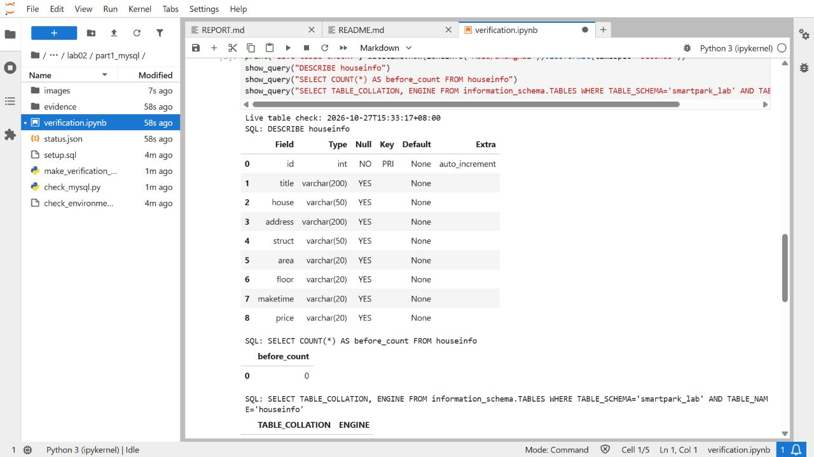
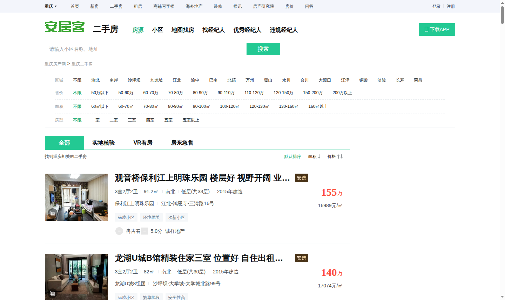

# 实验二总报告 · 房源采集与 MySQL 存储

姓名：李翔宇　　学号：112404260129　　班级：数据1241

## 一、实验目标与环境

在课程 Docker 环境中，用 Selenium 读取教学站的房源列表，使用 Python 解析、去重并保存 CSV，再通过 PyMySQL 将记录写入 MySQL。实验分为建表、采集和入库三部分。

在 `smartpark_lab` 中建立 `houseinfo` 表。表使用 InnoDB 和 `utf8mb4`，包含自增主键 `id` 和 8 个房源字段。首次建表检查时，表中有 0 条记录。[建表报告](part1_mysql/REPORT_part1.md) · [建表 SQL](part1_mysql/setup.sql)



## 二、网页采集与 CSV

直接请求网页时遇到访问验证，随后使用 Selenium 在浏览器中加载页面。程序从房源卡片提取字段，从“下一页”的 `href` 得到后续页面。第 10 页的“下一页”为 `#`，且没有启用样式。程序结合上一页链接和页码确认到达末页。修正这条判断后，用实际保存的 10 页网页重新解析并生成 CSV。

| 项目 | 结果 |
|---|---:|
| 实际保存页数 | 10 |
| 原始记录 | 600 |
| 8 字段完全相同的重复记录 | 102 |
| 去重后 CSV 数据行 | 498 |

CSV 字段依次为标题、小区、地址、户型、面积、楼层、建造年代和每平方米单价。文件使用 UTF-8-SIG 编码，面积、单价保留原单位。[CSV](data/houseinfo.csv) · [10 页来源清单](part2_collection/evidence/browser_full/manifest.json) · [采集报告](part2_collection/REPORT_part2.md)



## 三、入库过程与核验

Python 把磁盘上的 CSV 读入内存列表，校验表头、字段和来源哈希。程序比较房源的 8 个字段，用参数化 SQL 批量写入缺少的记录。写入成功后提交事务，异常时回滚。程序先处理少量样本，再处理全部记录，最后启动一个新的 Python 进程，用同一份 CSV 重跑。

2026 年 11 月 6 日核验时，数据库中已包含这批数据。执行前后均为 **498 条**，本次新增 **0 条**，独立重跑新增 **0 条**。程序确认 CSV 的全部记录都在库中，并核对以下样本的网页、CSV 和数据库字段。

| 样本 | 网页位置 | CSV 行号（含表头） | MySQL ID |
|---|---|---:|---:|
| 首条 | 第 1 页第 1 条 | 2 | 1 |
| 跨页 | 第 2 页第 1 条 | 62 | 61 |
| 末条 | 第 10 页第 60 条 | 499 | 498 |

[入库报告](part3_storage/REPORT_part3.md) · [逐字段核验记录](part3_storage/evidence/real_pipeline_result.json) · [入库状态](part3_storage/status.json)

## 四、复现方法

启动课程环境和 MySQL，在 JupyterLab 的 Terminal 中运行：

```bash
cd /home/pwuser/workspace/bigdata-collection-labs-112404260129/lab02
python part2_collection/collect_houses.py verify
python part3_storage/run_real_import.py
```

第一条 Python 命令核验现有 CSV 和网页来源。第二条会连接 MySQL，并按缺失记录执行写入。若要从保存的网页重新生成 CSV，按[采集运行说明](part2_collection/README.md)执行两页试采和完整回放。

本实验通过浏览器快照、CSV 和数据库三处核对房源，验证了分页结束条件及重复入库处理。早期 437 条版本的 MySQL 终端截图保存在分报告里，本版 498 条使用实际运行记录作为核验依据。
