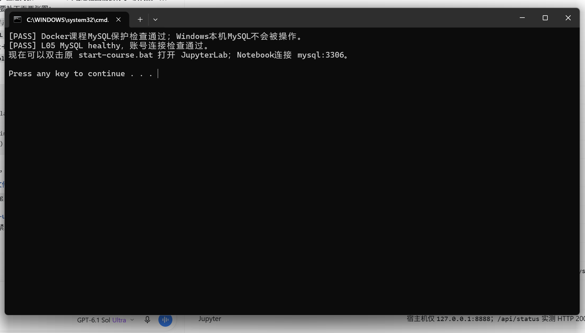
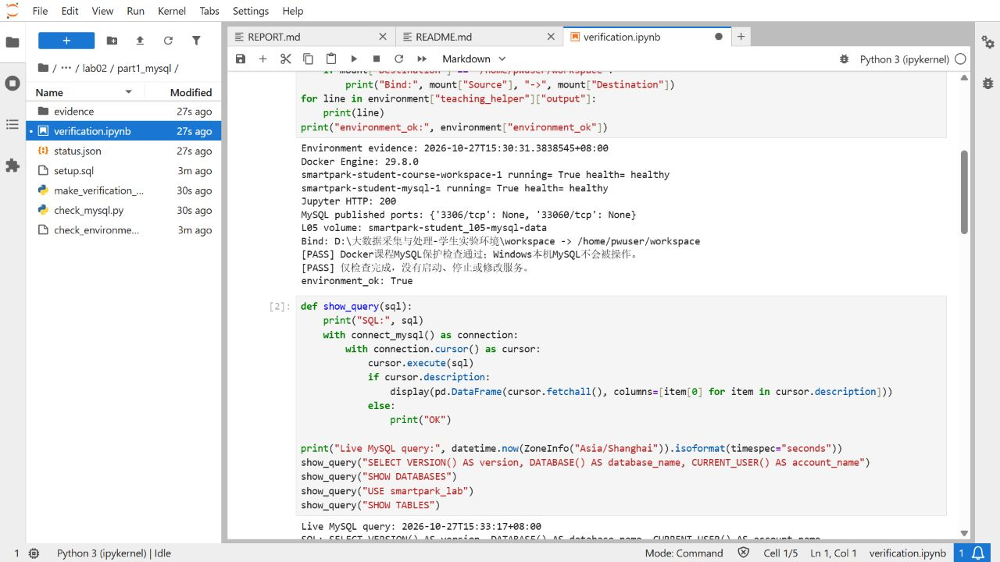
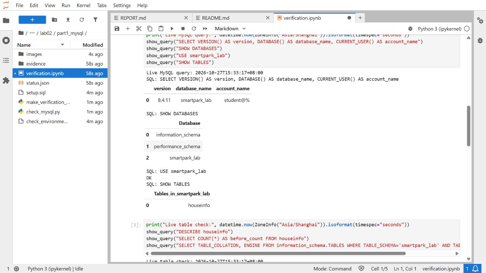
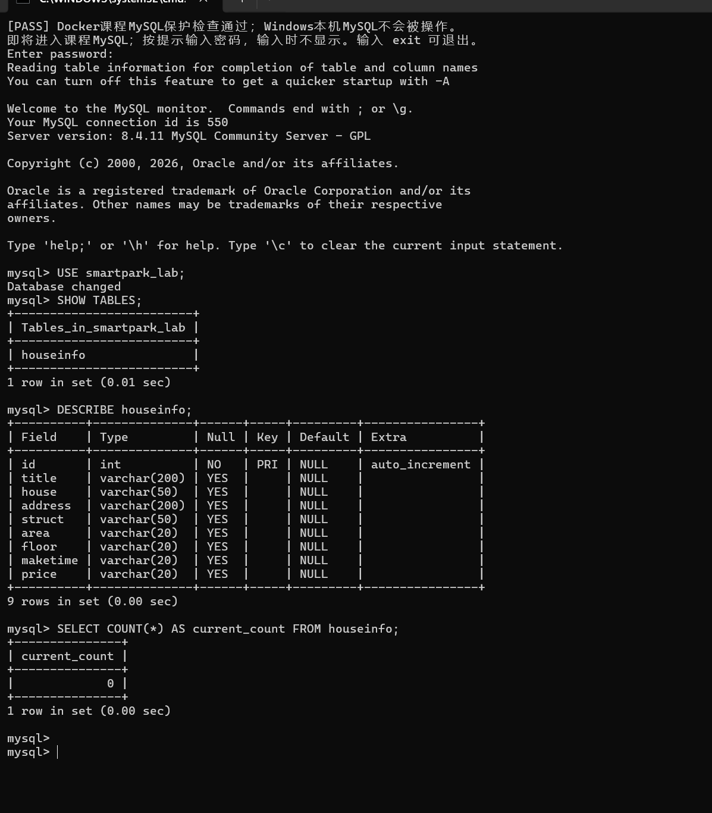
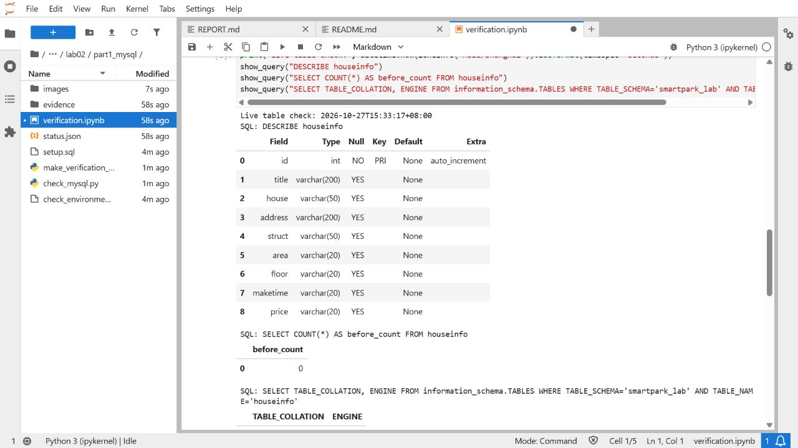

# 实验二：房源采集与 MySQL 存储——第一阶段实验报告

- 班级：数据1241
- 姓名：李翔宇
- 学号：112404260129
- 实验日期：2026年10月27日
- 作业仓库：[bigdata-collection-labs-112404260129](https://github.com/xiangyuli88x/bigdata-collection-labs-112404260129)
- 本阶段源码：[setup.sql](setup.sql)、[check_mysql.py](check_mysql.py)
- 运行核验：[verification.ipynb](verification.ipynb)
- 数据库与表：`smartpark_lab.houseinfo`

> 学生信息及仓库链接沿用同一作业仓库的实验一报告。本报告只记录第一阶段的环境检查、建表和入库前条数；第二、三阶段的采集与入库另有报告。下文保留原始实验时间，不把后续数据变化改写成初始结果。

## 一、实验目的

1. 确认课程 Docker、JupyterLab 和 MySQL 可用，使用 L05 教学数据卷及课程账号连接数据库。
2. 按实验手册建立 `houseinfo` 房源表，理解自增长主键和 8 个房源字段的作用。
3. 使用 `SHOW DATABASES`、`USE`、`SHOW TABLES`、`DESCRIBE` 和 `COUNT(*)` 检查数据库，记录入库前条数，为后续入库核对提供基线。

## 二、实验环境

课程环境已在前序配置工作中完成，本阶段复用已有环境并核验。L05 更新已完成，使用独立的教学数据卷，无需再次导入更新包。本阶段没有重建课程容器、修改密码或清空数据库。

| 项目 | 实际配置或检查结果 |
|---|---|
| 课程根目录 | `D:\大数据采集与处理-学生实验环境` |
| 课程容器 | `smartpark-student-course-workspace-1` |
| MySQL 容器 | `smartpark-student-mysql-1` |
| Docker Engine / Compose | 29.8.0 / 5.5.1 |
| MySQL / Python | 8.4.11 / 3.12.3 |
| 数据库连接 | 服务名 `mysql`，端口 `3306`，数据库 `smartpark_lab` |
| 课程账号 | `student`，实际认证账号 `student@%` |
| 连接字符集 | `utf8mb4` |
| MySQL 教学数据卷 | `smartpark-student_l05-mysql-data`，容器内挂载到 `/var/lib/mysql` |
| JupyterLab | `http://127.0.0.1:8888/lab`，原检查中 API 返回 HTTP 200 |
| MySQL 宿主机端口 | 未发布，课程 Python 通过 Docker 网络连接 `mysql:3306` |
| D 盘工作区挂载 | `D:\大数据采集与处理-学生实验环境\workspace` → `/home/pwuser/workspace` |

课程 Python 中已安装并成功导入 `requests`、`bs4` 和 `pymysql`，无需重复安装。三个安装包的版本为：`requests 2.34.2`、`beautifulsoup4 4.15.0`、`pymysql 1.2.0`；其中 BeautifulSoup 的安装名是 `beautifulsoup4`，导入名是 `bs4`。

## 三、实验步骤与实际结果

### 1. 检查环境，进入 MySQL

课程环境的启动入口是根目录中的 `start-course.bat`、`start-mysql.bat` 和 `mysql-console.bat`。本阶段在已有 Jupyter 环境上完成只读环境核验，随后补充了 MySQL 启动成功提示和交互终端的实际截图。



图1显示课程 MySQL 保护检查通过，以及“L05 MySQL healthy，账号连接检查通过”。这说明数据库健康检查和课程账号认证均已通过；截图中的 `Press any key to continue` 是脚本等待按键的提示，不是错误。



图2对应 2026-10-27 15:30:31 +08:00 保存的环境检查结果。课程容器与数据库均为 healthy，工作区实际挂载到 D 盘，Jupyter API 返回 200；MySQL 3306、33060 端口没有绑定到宿主机。原始记录见 [environment_20261027_153031_581.json](evidence/environment_20261027_153031_581.json)。

### 2. 查看数据库和数据表

实际执行的 SQL 如下，每条语句以分号结束：

```sql
SHOW DATABASES;
USE smartpark_lab;
SHOW TABLES;
```

`SHOW DATABASES` 查看当前账号可访问的数据库，`USE smartpark_lab` 选择本实验使用的库，`SHOW TABLES` 查看该库中的数据表。首次检查时库内尚无表；完成建表后，查询结果中出现 `houseinfo`。



图3显示版本为 MySQL 8.4.11，当前数据库为 `smartpark_lab`，认证账号为 `student@%`。切库成功后，`SHOW TABLES` 返回 `houseinfo`，说明表已位于本实验要求的数据库中。

### 3. 按手册建立 houseinfo 表

仅在表不存在时执行以下完整建表 SQL，源码保存在 [setup.sql](setup.sql)：

```sql
CREATE TABLE IF NOT EXISTS houseinfo (
    id INT AUTO_INCREMENT PRIMARY KEY COMMENT '自增长主键',
    title VARCHAR(200) COMMENT '标题',
    house VARCHAR(50) COMMENT '楼盘',
    address VARCHAR(200) COMMENT '地址',
    struct VARCHAR(50) COMMENT '户型',
    area VARCHAR(20) COMMENT '建筑面积',
    floor VARCHAR(20) COMMENT '楼层',
    maketime VARCHAR(20) COMMENT '建造年代',
    price VARCHAR(20) COMMENT '每平方米单价'
) CHARACTER SET utf8mb4;
```

`IF NOT EXISTS` 使已有同名表不会被重复创建。检查程序还会核对已有表的结构；若结构不符，只记录差异并失败，不通过修改或删除已有表来掩盖问题。本阶段没有写入任何房源记录。

### 4. 检查表结构

在 MySQL 中执行：

```sql
DESCRIBE houseinfo;
```



图4的 `DESCRIBE houseinfo` 返回完整的 9 列。`id` 的 `Key` 为 `PRI`，`Extra` 为 `auto_increment`；其余 8 列的名称、顺序、类型和长度均与手册一致。该图还显示切库成功、表列表和终端条数结果。

| 字段 | 实际类型 | 保存内容或作用 |
|---|---|---|
| id | INT | 自增长主键，由数据库生成每条记录的编号 |
| title | VARCHAR(200) | 房源标题 |
| house | VARCHAR(50) | 楼盘名称 |
| address | VARCHAR(200) | 房源地址 |
| struct | VARCHAR(50) | 户型，如“3室2厅1卫” |
| area | VARCHAR(20) | 建筑面积，保留面积单位 |
| floor | VARCHAR(20) | 楼层 |
| maketime | VARCHAR(20) | 建造年代 |
| price | VARCHAR(20) | 每平方米单价，保留价格单位 |

`id` 不允许为 NULL，其余 8 列允许 NULL，默认值均为 NULL。表引擎为 InnoDB，排序规则为 `utf8mb4_0900_ai_ci`，即使用 `utf8mb4` 字符集。程序同时核对了列顺序、长度、可空性、默认值、主键、自增和中文注释，结果 `schema_ok=true`。

### 5. 记录入库前条数

第一阶段实际执行了手册要求的查询：

```sql
SELECT COUNT(*) AS before_count FROM houseinfo;
```

`COUNT(*)` 统计记录数，`AS before_count` 将结果列命名为“入库前条数”。2026-10-27 15:30:46 +08:00 建表后的查询返回 **0**；15:33:17 +08:00 的独立重跑检查仍为 **0**，且 `created_table=false`，没有再次建表或插入房源。



图5是已实际执行的 Jupyter 核验结果，清楚显示 `SELECT COUNT(*) AS before_count FROM houseinfo` 返回 0。原始 SQL、表结构和计数分别保存在 [首次建表日志](evidence/mysql_20261027_153046_419060.txt) 和 [独立重跑日志](evidence/mysql_20261027_153317_689001.txt)，可以与截图互相核对。

图4的历史交互终端图执行的是 `SELECT COUNT(*) AS current_count FROM houseinfo;`，结果同样为 0。`current_count` 与 `before_count` 都是查询结果的别名，不改变统计的表和数值；报告按原图保留这个差异，没有修改截图文字。平台题目示例采用 `before_count` 别名，该形式的实际执行结果由图5及原始日志提供；历史终端图采用 `current_count`，两种证据分别说明，不互相冒充。

## 四、结果汇总与时间说明

| 检查时点 | 实际结果 | 证据 |
|---|---|---|
| 第一阶段首次检查 | `houseinfo` 不存在，`SHOW TABLES` 为空 | 首次建表 JSON 中的 `tables_before` |
| 2026-10-27 15:30:46 +08:00 | 创建表成功，9 列结构符合手册，`before_count=0` | [首次建表 JSON](evidence/mysql_20261027_153046_419060.json) |
| 2026-10-27 15:33:17 +08:00 | 已有表核验通过，未再次建表，条数仍为 0 | [独立重跑 JSON](evidence/mysql_20261027_153317_689001.json) |
| 后补历史 MySQL 终端原图 | 切库、表结构和 `current_count=0` 均可见，原图未显示拍摄时间 | 图4；[原图来源与哈希](evidence/user_screenshots.json) |
| 后续第三阶段，2026-10-27 16:59:35 +08:00 | 由 0 条导入至 437 条，独立重跑新增 0 条 | [第三阶段状态记录](../part3_storage/status.json) |
| 报告整理时只读复核，2026-10-27 21:45:55 +08:00 | 当前 437 条，结构与第一阶段一致 | [本次只读复核记录](evidence/report_review_20261027_214555.json) |

**第一阶段的入库前条数为 0；后续入库完成后的总条数为 437。** 两个数字对应不同阶段，不矛盾。本次整理报告只执行只读查询，未改变数据库记录，也未将第一阶段状态文件中的历史 `before_count=0` 和检查时间改成当前值。

## 五、字段与操作说明

**当前使用哪个数据库？** 使用 `smartpark_lab`，房源表为 `houseinfo`。`mysql` 是 Docker 网络中的数据库服务名，`3306` 是连接端口，二者与数据库名作用不同。

**id 和 8 个房源字段分别保存什么？** `id` 是数据库自动生成的唯一编号。其余字段按 `title → house → address → struct → area → floor → maketime → price` 保存标题、楼盘、地址、户型、建筑面积、楼层、建造年代和每平方米单价；第一阶段只建立结构，数据由后续阶段写入。

**数据库实际保存在哪里？** 数据库运行在 `smartpark-student-mysql-1` 容器中，实际数据由教学卷 `smartpark-student_l05-mysql-data` 持久保存，挂载到容器的 `/var/lib/mysql`。本地 `setup.sql` 保存的是建表指令，不是数据库数据文件。

**为什么要记录 before_count？** 后续导入完成后，用 `after_count - before_count` 计算本次新增条数。本次历史基线是 0，后续阶段记录的 `after_count` 是 437，因此该次入库新增 437 条；这一计算引用后续阶段的真实状态记录。

## 六、遇到的问题及处理

1. 首次检查程序把 `current_user` 用作未加引号的 SQL 别名，MySQL 返回 1064 语法错误。将别名改为 `account_name` 后实际重跑成功，失败时尚未执行建表或写入数据。[失败日志](evidence/mysql_20261027_153032_214829.txt) 与成功日志均保留。
2. Notebook 执行器曾提示内核 TCP 连接未加密。这是警告；已保存的 4 个代码单元实际执行完成，单元错误数为 0。
3. 第一阶段的初始计数与后续数据库总数不同。通过区分原始实验记录和报告整理时的只读复核，保留了入库前 0 条与入库后 437 条的时间关系，没有改写历史截图。

## 七、证据与提交核对

- [x] `houseinfo` 的 9 列结构、主键、自增、字段注释和 `utf8mb4` 已按手册核对。
- [x] MySQL 启动成功提示、交互终端的切库和表结构原图已保存。
- [x] 历史入库前条数 0 有实际 SQL 日志、Jupyter 截图和 MySQL 终端图支持；终端图的列名差异已在正文说明。
- [x] 原图保留未改；报告图片和附件使用相对路径引用。
- [x] 第一阶段没有写入房源，已保留后续阶段导入后的 437 条数据。
- [ ] 本阶段未执行 GitHub 上传或学习通提交，仓库链接不代表本次文件已发布。

截图说明：本次复用已运行的课程环境，未新增重新运行 `start-course.bat` 的手工过程图；已有 Jupyter 实际访问与运行结果证据。历史 MySQL 终端的条数表头为 `current_count`，图5中的 `before_count` 结果属于 Jupyter 查询，不能将其写成 MySQL 交互终端截图；现有资料没有说明平台是否按别名逐字符评分。

若只按学习平台截图题上传，应使用表结构和条数查询结果图；启动成功提示图只作为环境证据。现有图4包含表结构和条数两项实际结果，报告同时保留图5及日志作为手册查询形式的补充证据。

## 附：文件与复核方法

| 文件或目录 | 用途 |
|---|---|
| [setup.sql](setup.sql) | 完整建表 SQL 和基础验收查询 |
| [check_environment.ps1](check_environment.ps1) | 只读检查 Docker、挂载、教学卷和 Jupyter |
| [check_mysql.py](check_mysql.py) | 环境准备时检查账号、必要时建表并核对结构 |
| [verification.ipynb](verification.ipynb) | 保留已执行的 4 个核验单元；最后一个单元会重新生成检查状态 |
| [status.json](status.json) | 本阶段的结构验收及历史入库前基线 |
| [MySQL 客户端原始输出](evidence/mysql_cli.txt) | 真实命令行客户端的查询输出 |
| [安全重跑核验原图](images/04_safe_recheck.jpg) | 历史独立重跑结果补充证据 |
| [较早的交互终端原图](images/06_mysql_console.png) | 保留第一次补图的过程记录 |
| `images/`、`evidence/` | 截图、日志、原图校验及报告整理时的复核记录 |

需要查看当前数据库时，可在课程 MySQL 终端执行：

```sql
USE smartpark_lab;
SHOW TABLES;
DESCRIBE houseinfo;
SELECT COUNT(*) AS current_count FROM houseinfo;
```

这组 SQL 只查询当前结构和条数。第一阶段的初始 0 条取自已保存的原始证据，不用当前数据重新生成或覆盖该历史结果。

AI 协助内容：编写与检查环境核验程序、运行只读查询、整理 SQL、日志和报告。MySQL 实际查询结果与手工终端原图均已保留；报告没有将未观察到的操作或预期输出写成已完成事项。
