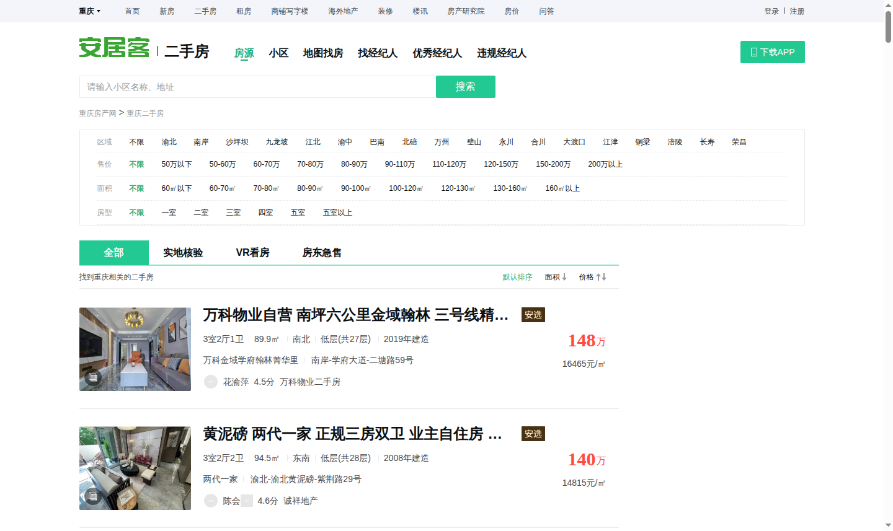
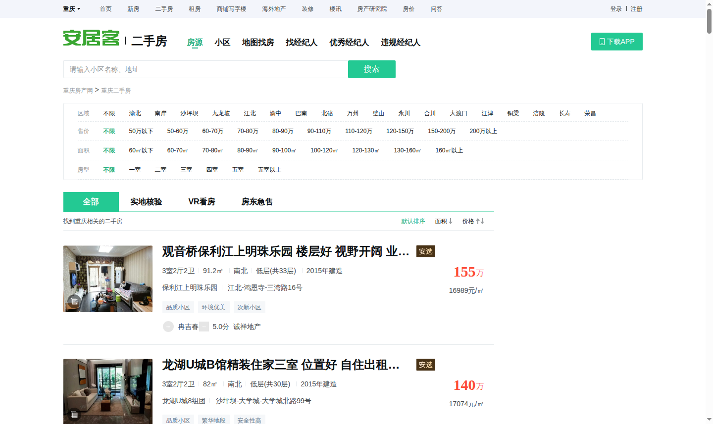

# 实验二 · 房源采集

本次使用 Selenium 打开教学站房源列表，按页面的下一页链接依次保存网页。第 10 页的“下一页”链接为 `#`，按钮没有启用样式。程序结合上一页链接和页码确认到达末页。[浏览器来源清单](evidence/browser_full/manifest.json)

| 项目 | 结果 |
|---|---:|
| 采集页数 | 10 |
| 原始房源 | 600 |
| 八字段完全相同的重复记录 | 102 |
| CSV 数据行数 | 498 |

每条记录包含标题、小区、地址、户型、面积、楼层、建造年代和每平方米单价。面积和单价保留原单位。CSV 使用 UTF-8-SIG 编码。[下载 CSV](../data/houseinfo.csv)

早期直接请求网页时遇到访问验证，随后改用浏览器采集。首次识别末页时，程序将第 10 页的禁用按钮当成异常。修正判断后，使用已保存的 10 页真实网页重新解析，在第 10 页正常结束。两页试采、完整回放和 CSV 校验的结果见[采集状态](status.json)。

