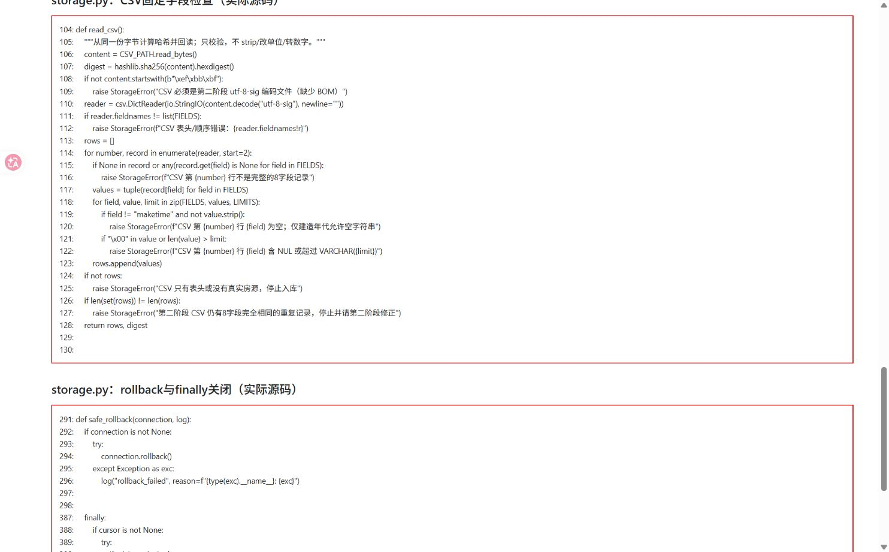
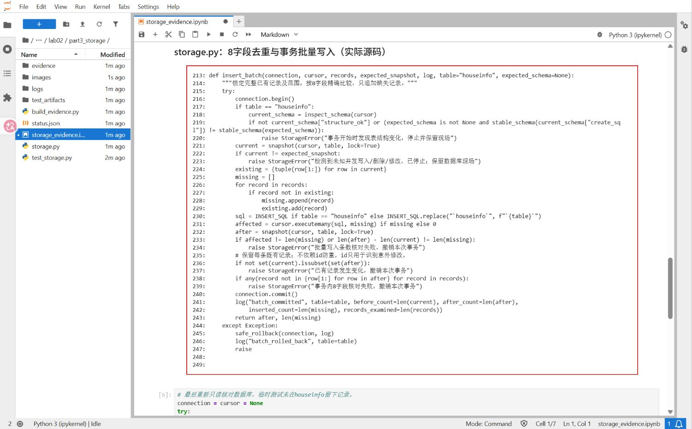
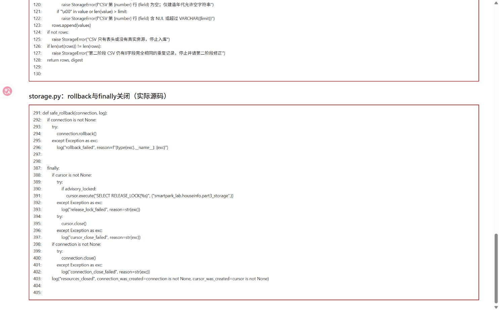
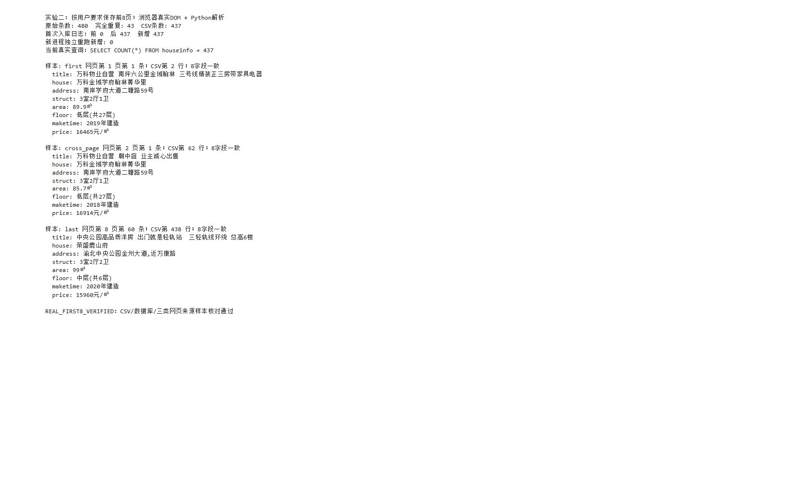
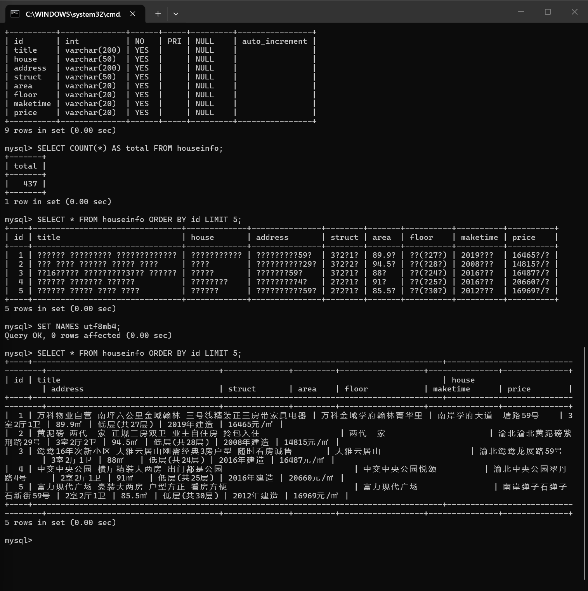

# 实验二：房源数据的 MySQL 存储

- 班级：________
- 姓名：________
- 学号：________
- 实验日期：2026年10月27日
- 实验内容：第三阶段——读取 CSV 并写入 MySQL

## 一、实验目的

掌握使用 PyMySQL 连接数据库、读取 CSV、批量写入数据和核对结果的方法。理解事务提交与回滚的作用，并能够处理重复运行时的数据重复问题。

## 二、实验环境与数据

本实验在课程 Docker 环境中运行，使用 Python 3.12.3、MySQL 8.4.11 和 PyMySQL。数据库为 `smartpark_lab`，房源表为 `houseinfo`。

本阶段读取第二阶段生成的 `data/houseinfo.csv`，不重新采集网页。本次数据范围为教学站前8页，共480条记录，按8个字段完全相同去重后得到437条。前8页由浏览器访问并保存页面，再通过 Python 解析；本次未采集到站点末页。

入库字段按以下顺序排列，数据库另外生成自增长主键 `id`：

| 顺序 | 字段 | 含义 |
|---|---|---|
| 1 | title | 房源标题 |
| 2 | house | 楼盘名称 |
| 3 | address | 地址 |
| 4 | struct | 户型 |
| 5 | area | 建筑面积 |
| 6 | floor | 楼层 |
| 7 | maketime | 建造年代 |
| 8 | price | 每平方米单价 |

## 三、实验过程

### 1. 读取并检查 CSV

使用 `csv.DictReader` 读取 UTF-8-SIG 编码的 CSV，检查表头是否与上述8个字段一致，再按固定顺序整理每条记录。每条记录必须恰好包含8项，建造年代缺失时允许为空字符串，其他必要字段不能为空。

面积、价格和地址均保留 CSV 中的原文字，不去掉单位，也不改变原有空格。例如，面积 `89.9㎡` 和单价 `16465元/㎡` 以字符串形式保存。



图中代码检查了编码、表头、字段数量和重复记录。完整性检查只用于判断数据是否符合要求，不修改原字段内容。

### 2. 连接数据库并批量写入

使用 `pymysql.connect()` 连接课程数据库，设置 `charset="utf8mb4"` 和 `autocommit=False`，再通过 `connection.cursor()` 创建游标。写入前先核对表结构，并查询已有记录及条数。

INSERT 语句明确列出8个字段，每条记录的8个值按相同顺序传入：

```sql
INSERT INTO houseinfo
(title, house, address, struct, area, floor, maketime, price)
VALUES (%s, %s, %s, %s, %s, %s, %s, %s);
```

`%s` 是参数占位符，数据通过 `cursor.executemany(sql, records)` 的第二个参数传入，不直接拼接到 SQL 中。先写入3条真实记录并回读核对，确认字段正确后，再写入其余434条记录。



写入前将已有记录的8个字段组成元组，与 CSV 记录逐项比较，只插入尚不存在的记录。自增长 `id` 不能防止房源重复，因此本实验按8字段内容判断重复，不通过清空表实现重跑。

### 3. 提交、回滚与关闭连接

每批写入完成并核对通过后调用 `commit()` 提交。若本批写入出现异常，则调用 `rollback()` 撤销尚未提交的修改；已经提交成功的批次会保留。

程序在 `finally` 中先关闭游标，再关闭数据库连接。连接和游标先初始化为 `None`，避免连接失败后对尚未创建的对象执行关闭操作。



图中 `rollback()` 用于失败处理，`cursor.close()` 和 `connection.close()` 用于释放资源。关闭操作前判断对象是否存在，使连接建立失败时也能正确结束程序。

### 4. 独立重跑与结果核对

首次入库结束并关闭连接后，启动新的 Python 进程，再次读取同一份 CSV 并连接数据库。第二次运行没有新增记录，说明同批数据重复执行时不会重复插入。

另外抽取 CSV 首条、第二页首条和第8页末条，比较保存的网页、CSV 与数据库中的8个字段，核对结果如下：

| 样本 | 网页位置 | CSV行号（含表头） | 数据库id | 核对结果 |
|---|---|---:|---:|---|
| 首条 | 第1页第1条 | 2 | 1 | 8字段全部一致 |
| 跨页样本 | 第2页第1条 | 62 | 61 | 8字段全部一致 |
| 本次范围末条 | 第8页第60条 | 438 | 437 | 8字段全部一致 |

## 四、实验结果

| 项目 | 实际结果 |
|---|---:|
| 采集页数 | 8页 |
| 去重前记录数 | 480条 |
| 完全重复记录数 | 43条 |
| CSV数据行数 | 437条 |
| 入库前条数 | 0条 |
| 入库后条数 | 437条 |
| 本次新增条数 | 437条 |
| 新进程独立重跑后的总条数 | 437条 |
| 新进程独立重跑新增条数 | 0条 |



图中首次入库前后的条数来自当次运行日志，当前数据库条数和三个样本则通过新的数据库连接再次查询。CSV、数据库与所保存网页中的样本内容一致，面积、单价及建造年代均按原文字保留。

### MySQL 交互终端查询

在 MySQL 交互终端中执行 `DESCRIBE houseinfo;`，查询结果包含自增长主键和8个房源字段；执行 `SELECT COUNT(*) AS total FROM houseinfo;`，结果为437条；再执行 `SELECT * FROM houseinfo ORDER BY id LIMIT 5;`，查看前5条房源记录。

首次查询时中文显示为问号，执行 `SET NAMES utf8mb4;` 后重新查询，中文恢复正常，说明问题出在当前连接的字符编码设置。



## 五、问题与分析

1. **重复运行可能产生重复数据。** `id` 每次都会自动生成，不能作为房源是否重复的依据。本实验比较标题、楼盘、地址等8个字段，只写入不存在的记录；独立重跑新增0条，验证了该处理方法。
2. **字段顺序不一致可能导致数据写错列。** 读取 CSV 和 INSERT 使用同一组固定字段顺序，并在入库后逐字段回读核对。
3. **面积和单价包含单位。** 本实验使用 VARCHAR 字段保存原文字，没有把 `㎡`、`元/㎡` 等单位去掉。

## 六、实验小结

本实验将437条去重后的房源记录写入 MySQL，并完成了条数及样本核对。通过少量记录验证、批量写入和新进程重跑，验证了字段对应关系及重复数据处理方法。事务提交、异常回滚和资源关闭使程序能够安全结束，并保留已经成功提交的数据。

## 补充说明

- 完整源码位于原作业仓库的 `lab02/part3_storage/`，主要文件为 `storage.py` 和 `run_real_import.py`；本次已执行的查询结果保存在 `first8_result.ipynb`。
- 已在 MySQL 交互终端执行表结构、记录数和前5条记录查询。`SET NAMES utf8mb4;` 设置当前连接字符集后，中文、面积和单价单位均正常显示。
- 使用 AI 辅助代码整理与错误排查；报告中的数据、条数和核对结果来自实际运行。