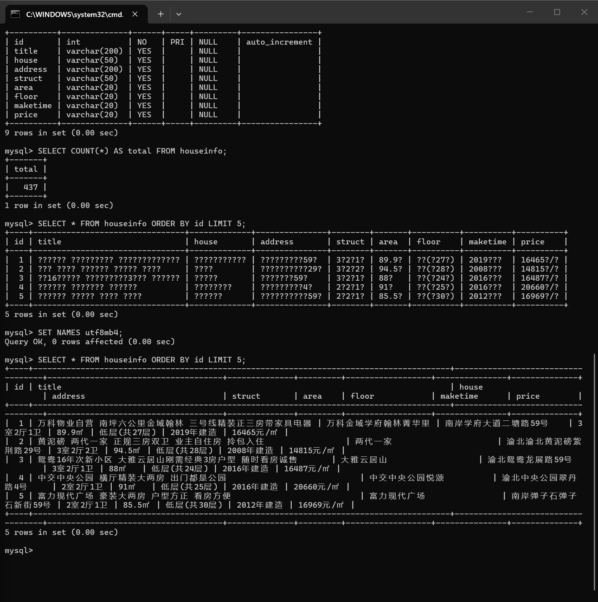

# 实验二 · CSV 入库

Python 读取 [houseinfo.csv](../data/houseinfo.csv)，把每条记录的 8 个字段暂存在内存列表中。程序核对 CSV 与网页来源后，通过 PyMySQL 对比已有数据，将缺少的房源用参数化 SQL 批量写入 `smartpark_lab.houseinfo`。成功后提交事务，异常时回滚并关闭连接。

| 2026 年 11 月 6 日的核验项目 | 结果 |
|---|---:|
| CSV 数据行数 | 498 |
| 本次执行前的表记录数 | 498 |
| 本次新增 | 0 |
| 执行后的表记录数 | 498 |
| 新进程独立重跑新增 | 0 |

执行前数据库已包含这批数据。程序先处理少量样本，再核对全量数据。全部 498 条均在库中，首条、跨页样本和末条的 8 个字段均与原网页一致。

| 样本 | 网页位置 | CSV 行号（含表头） | MySQL ID |
|---|---|---:|---:|
| 首条 | 第 1 页第 1 条 | 2 | 1 |
| 跨页 | 第 2 页第 1 条 | 62 | 61 |
| 末条 | 第 10 页第 60 条 | 499 | 498 |

逐项数据和新进程结果见[完整核验记录](evidence/real_pipeline_result.json)和[入库状态](status.json)。

如需用 MySQL 交互终端核查，在课程根目录运行 `mysql-console.bat`，进入 `mysql>` 后执行：

```sql
SET NAMES utf8mb4;
USE smartpark_lab;
SELECT COUNT(*) AS total FROM houseinfo;
SELECT * FROM houseinfo WHERE id IN (1, 61, 498) ORDER BY id\G
```

下图是前 8 页版本的历史交互终端截图，显示当时的 437 条记录和中文查询结果。本次 498 条结果以本报告所链接的实跑记录为准。


